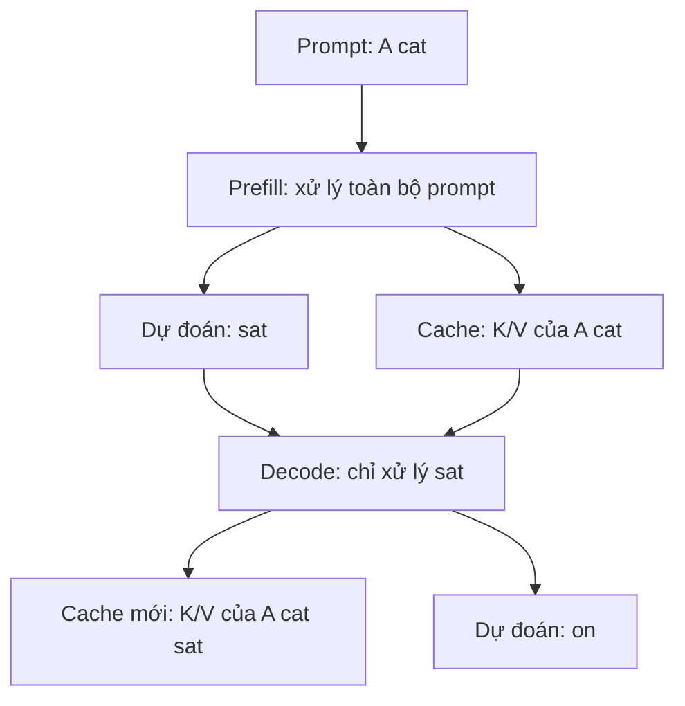

# KV Cache trong Transformer: “trí nhớ tạm” giúp GPT trả lời nhanh hơn

> Tài liệu này giải thích KV Cache từ trực giác đến mã PyTorch. Mục tiêu là giúp các bạn mới học đã biết sơ qua Transformer có thể hiểu: **Mô hình đang lưu gì, vì sao phải lưu, tensor đổi hình dạng ra sao và đoạn mã hoạt động thế nào**.

---

## 1. Vấn đề: GPT đang làm lại bài cũ

GPT không viết cả câu trong một lần. Nó sinh từng token:

```text
"A cat"  → dự đoán "sat"
"A cat sat" → dự đoán "on"
"A cat sat on" → dự đoán "the"
```

Một vòng lặp sinh văn bản đơn giản thường làm như sau:

```python
for _ in range(max_new_tokens):
    logits = model(all_tokens)        # gửi lại toàn bộ câu
    next_token = sample(logits[:, -1])
    all_tokens = torch.cat([all_tokens, next_token], dim=1)
```

Đoạn mã này đúng, nhưng lãng phí. Khi câu dài thêm một token, mô hình lại xử lý toàn bộ phần cũ.

Ví dụ:

| Lần chạy | Token được đưa vào mô hình | Công việc bị lặp |
|---|---|---|
| 1 | `A cat` | Chưa có |
| 2 | `A cat sat` | Tính lại cho `A`, `cat` |
| 3 | `A cat sat on` | Tính lại cho `A`, `cat`, `sat` |
| 4 | `A cat sat on the` | Tính lại gần như tất cả |

Hãy tưởng tượng bạn đang giải một bài toán dài. Mỗi khi viết thêm một dòng, bạn xóa bài và làm lại từ dòng đầu. Kết quả vẫn đúng, nhưng cách làm quá tốn thời gian.

Trong Self-Attention, phần bị tính lại đáng chú ý là **Key (K)** và **Value (V)** của những token cũ. Một token đã nằm trong quá khứ thì biểu diễn K/V của nó tại một tầng Transformer không tự nhiên thay đổi giữa các bước sinh tiếp theo. Vì vậy, ta có thể giữ lại và dùng tiếp.

---

## 2. KV Cache là gì?

KV Cache (Key-Value Cache) là một kỹ thuật lưu trữ tạm thời giúp các mô hình ngôn ngữ (LLM) tạo ra văn bản nhanh hơn rất nhiều và tiết kiệm chi phí tính toán.

Nếu không có KV Cache, LLM sẽ càng gõ càng chậm. Để hiểu tại sao, hãy bắt đầu từ bản chất cách LLM hoạt động.

**Mối liên hệ: LLM sinh từ như thế nào?**

Khi bạn yêu cầu LLM viết một câu, nó không tạo ra toàn bộ câu cùng lúc mà sinh từng từ một (token by token):

```
Bước 1: Nhận vào "Hà" -> Dự đoán từ tiếp theo là "Nội".
Bước 2: Nhận vào "Hà Nội" -> Dự đoán từ tiếp theo là "là".
Bước 3: Nhận vào "Hà Nội là" -> Dự đoán từ tiếp theo là "thủ".
Bước 4: Nhận vào "Hà Nội là thủ" -> Dự đoán từ tiếp theo là "đô".
```

Trong kiến trúc Transformer, cơ chế Self-Attention cần tính toán mối quan hệ giữa từ mới và tất cả các từ đứng trước nó. Để làm việc này, mô hình phải biến đổi mỗi từ thành 2 vectơ quan trọng: **Key (K) và Value (V)**.

**Vấn đề nếu không có KV Cache (Lãng phí tính toán)**

Ở Bước 4 `"Hà Nội là thủ"`:

- Mô hình phải tính toán lại K và V cho từ `"Hà"`.
- Tính lại K và V cho từ `"Nội"`.
- Tính lại K và V cho từ `"là"`.
- Tính lại K và V cho từ `"thủ"`.

Bạn có thể thấy: K và V của các từ `"Hà", "Nội", "là"` đã được tính từ các bước trước rồi, nhưng nếu không lưu lại, mô hình bắt buộc phải tính toán lại từ đầu cho mọi token cũ.

Khi đoạn văn dài đến hàng nghìn từ, việc tính lại toàn bộ quá khứ ở mỗi từ mới sẽ khiến tốc độ tạo văn bản chậm đi khủng khiếp (độ phức tạp $$O(N^2)$$).

**Giải pháp: KV Cache**

KV Cache giải quyết đúng lãng phí này bằng một nguyên lý đơn giản: Tính đến đâu, lưu lại đến đó.

- Lần đầu tiên: Khi xử lý câu lệnh (prompt) ban đầu, mô hình tính toán Key và Value cho tất cả các từ trong prompt rồi lưu vào bộ nhớ RAM/VRAM (gọi là KV Cache).

- Các bước tiếp theo: Khi sinh từ mới, mô hình chỉ tính Key và Value cho duy nhất từ mới đó.

- Sau đó, nó lấy các K và V cũ đã lưu trong KV Cache ra kết hợp với K và V mới để dự đoán từ tiếp theo.

Tóm lại:

1. Chỉ tính Q, K và V cho token mới.
2. Ghép K mới vào K cũ.
3. Ghép V mới vào V cũ.
4. Dùng Q mới để “nhìn” toàn bộ K/V trong cache.
5. Trả cache đã cập nhật cho bước sau.

Công thức ngắn gọn:

$$
K_{\text{all}} = \text{concat}(K_{\text{past}}, K_{\text{new}})
$$

$$
V_{\text{all}} = \text{concat}(V_{\text{past}}, V_{\text{new}})
$$

$$
Y_{\text{new}} = \text{softmax}\left( \frac{Q_{\text{new}} K_{\text{all}}^T}{\sqrt{d_h}} \right) V_{\text{all}}
$$

Trực giác dễ hình dung:

- **K** giống như nhãn ở gáy sách: giúp xác định thông tin nào có liên quan.
- **V** giống như nội dung hữu ích trong cuốn sách đó.
- **Q** là câu hỏi hiện tại.
- **KV Cache** là giá sách đã được sắp sẵn; không cần đem sách cũ đi phân loại lại mỗi lần có câu hỏi mới.

> KV Cache không phải “ký ức lâu dài” của chatbot. Nó chỉ tồn tại trong lúc mô hình đang xử lý một chuỗi hoặc một phiên sinh cụ thể. Khi cache bị xóa, mô hình không còn giữ các K/V đó.

**Bảng so sánh:**

| Tiêu chí | Không dùng KV Cache | Có dùng KV Cache |
| :--- | :--- | :--- |
| **Khối lượng tính toán** | Tăng theo cấp số nhân khi câu dài ra. | Giữ nguyên cho mỗi từ mới (chỉ tính 1 token). |
| **Tốc độ sinh chữ** | Càng về sau càng chậm. | Tốc độ ổn định, nhanh hơn gấp nhiều lần. |
| **Đổi lại (Trade-off)** | Tiết kiệm RAM/VRAM. | Tốn dung lượng VRAM để lưu bộ nhớ đệm KV. |

## 3. Hai giai đoạn: Prefill và Decode

Đây là cách nhìn rất quan trọng trong hệ thống LLM thực tế.

### 3.1. Prefill: đọc prompt lần đầu

Giả sử người dùng nhập:

```text
A cat
```

Mô hình phải xử lý cả prompt để:

- tạo logits dự đoán token tiếp theo;
- tạo K và V của `A`, `cat` ở từng tầng;
- lưu chúng vào cache.

Giai đoạn này gọi là **prefill**.

### 3.2. Decode: sinh từng token mới

Sau prefill, mô hình dự đoán `sat`. Ở vòng tiếp theo, nó chỉ cần nhận token `sat`, đồng thời dùng lại cache của `A cat`.



Trình tự đúng là:

```text
Xử lý "A cat"       → dự đoán "sat"
Xử lý riêng "sat"   → dự đoán "on"
Xử lý riêng "on"    → dự đoán "the"
```

Không phải đưa `sat` vào để dự đoán chính `sat`. Token đầu vào ở một bước được dùng để dự đoán token đứng **sau** nó.

---

## 4. Nhắc lại vai trò của Q, K và V

Trong một head attention, từ tensor đầu vào $X$, mô hình tạo ra:

$$
Q=XW_Q,\qquad K=XW_K,\qquad V=XW_V
$$

Sau đó:

$$
\{Attention}(Q,K,V)=
\{softmax}\left(\frac{QK^T}{\sqrt{d_h}}+M\right)V
$$

Trong đó:

- $Q$ — **Query**: token hiện tại đang tìm điều gì?
- $K$ — **Key**: mỗi token có đặc điểm gì để được tìm thấy?
- $V$ — **Value**: nếu token đó quan trọng thì lấy thông tin nào từ nó?
- $d_h$ — số chiều của một attention head.
- $M$ — causal mask, ngăn token nhìn thấy tương lai.

Ví dụ câu:

```text
Con mèo uống sữa vì nó khát.
```

Khi xử lý từ `nó`, Query của `nó` có thể khớp mạnh với Key của `mèo`. Sau softmax, Value của `mèo` đóng góp nhiều hơn vào biểu diễn mới của `nó`.

### Vì sao cache K và V mà không cache Q?

Trong lúc decode, ta chỉ cần kết quả attention cho token mới nhất:

- Q của token cũ đã hoàn thành nhiệm vụ ở bước cũ.
- Q mới cần so sánh với tất cả K cũ.
- Các V cũ vẫn cần thiết để tổng hợp thông tin.

Vì vậy, mô hình lưu **K và V**, không cần giữ toàn bộ Q cũ.

---

## 5. Theo dõi hình dạng tensor

Trước khi đọc mã, hãy thống nhất ký hiệu:

| Ký hiệu   | Ý nghĩa                             |
| --------- | ----------------------------------- |
| `B`       | Batch size — số câu xử lý cùng lúc  |
| `T_new`   | Số token mới trong lần gọi hiện tại |
| `T_past`  | Số token đã nằm trong cache         |
| `T_total` | `T_past + T_new`                    |
| `C`       | Kích thước embedding (`n_embd`)     |
| `H`       | Số attention head (`n_head`)        |
| `D`       | Kích thước mỗi head, `D = C // H`   |

Trong decode thông thường, `T_new = 1`.

Giả sử:

```text
B = 1
T_past = 2
T_new = 1
C = 8
H = 2
D = C / H = 4
```

Hình dạng các tensor:

| Tensor                  |          Shape | Chứa thông tin của       |
| ----------------------- | -------------: | ------------------------ |
| `x`                     |    `(1, 1, 8)` | token mới                |
| `q_new`                 | `(1, 2, 1, 4)` | token mới                |
| `k_new`, `v_new`        | `(1, 2, 1, 4)` | token mới                |
| `past_k`, `past_v`      | `(1, 2, 2, 4)` | 2 token cũ               |
| `k_all`, `v_all`        | `(1, 2, 3, 4)` | 2 token cũ + 1 token mới |
| `scores`                | `(1, 2, 1, 3)` | 1 query so với 3 key     |
| `y` trước khi ghép head | `(1, 2, 1, 4)` | kết quả của 2 head       |
| `y` sau khi ghép head   |    `(1, 1, 8)` | kết quả cuối             |

Phép nhân quan trọng nhất:

```text
q_new                         @ k_all.transpose(-2, -1)
(B, H, T_new, D)              @ (B, H, D, T_total)

→ scores: (B, H, T_new, T_total)
```

Sau đó:

```text
scores                        @ v_all
(B, H, T_new, T_total)        @ (B, H, T_total, D)

→ y: (B, H, T_new, D)
```

### Vì sao `torch.cat(..., dim=-2)`?

Tensor K/V có thứ tự chiều:

```text
(B, H, T, D)
```

Chiều `-1` là `D`, còn chiều `-2` là `T`. Ta muốn nối thêm **token**, nên phải nối ở `dim=-2`.

```python
k_all = torch.cat([past_k, k_new], dim=-2)
```

Nếu nối nhầm ở `dim=-1`, bạn sẽ làm tăng kích thước vector của head thay vì tăng độ dài câu.

---

## 6. Ví dụ từng bước với câu “A cat sat”

Ta bắt đầu với prompt `A cat`.

### Bước 1 — Prefill

```text
Đầu vào: [A, cat]
Cache cũ: chưa có
```

Mô hình tính:

```text
Q = [q_A, q_cat]
K = [k_A, k_cat]
V = [v_A, v_cat]
```

Sau attention, logits tại vị trí `cat` dự đoán token tiếp theo là `sat`.

Cache được giữ lại:

```text
K_cache = [k_A, k_cat]
V_cache = [v_A, v_cat]
```

### Bước 2 — Decode token `sat`

```text
Đầu vào mới: [sat]
Cache cũ: K/V của [A, cat]
```

Chỉ token `sat` được chiếu qua $W_Q$, $W_K$, $W_V$:

```text
q_new = [q_sat]
k_new = [k_sat]
v_new = [v_sat]
```

Ghép cache:

```text
K_all = [k_A, k_cat, k_sat]
V_all = [v_A, v_cat, v_sat]
```

Attention lúc này là:

```text
q_sat so sánh với [k_A, k_cat, k_sat]
```

Mô hình dùng kết quả để dự đoán `on`, rồi cập nhật cache thành K/V của `A cat sat`.

### So sánh lượng K/V phải tính mới

| Bước           | Không có cache          | Có cache   |
| -------------- | ----------------------- | ---------- |
| Prompt `A cat` | `A`, `cat`              | `A`, `cat` |
| Nhận `sat`     | `A`, `cat`, `sat`       | chỉ `sat`  |
| Nhận `on`      | `A`, `cat`, `sat`, `on` | chỉ `on`   |
| Nhận `the`     | tính lại cả chuỗi       | chỉ `the`  |

Cache không thay đổi kết quả toán học, nó chỉ tránh thực hiện lại phần đã có.

---

## 7. Cài đặt KV Cache bằng PyTorch

Đoạn mã dưới đây tập trung vào một lớp Causal Self-Attention. Nó hỗ trợ cả:

- prefill với nhiều token;
- decode với một hoặc vài token mới;
- causal mask có tính đến độ dài cache.

```python
import math
import torch
import torch.nn as nn
import torch.nn.functional as F


class CausalSelfAttention(nn.Module):
    def __init__(self, n_embd: int, n_head: int, dropout: float = 0.0):
        super().__init__()

        assert n_embd % n_head == 0

        self.n_embd = n_embd
        self.n_head = n_head
        self.head_dim = n_embd // n_head

        # Một phép chiếu tạo đồng thời Q, K và V.
        self.c_attn = nn.Linear(n_embd, 3 * n_embd)
        self.c_proj = nn.Linear(n_embd, n_embd)
        self.resid_dropout = nn.Dropout(dropout)

    def forward(self, x, past_kv=None, use_cache=False):
        """
        x:       (B, T_new, C)
        past_kv: None hoặc tuple (past_k, past_v)
                 mỗi tensor có shape (B, H, T_past, D)
        """

        B, T_new, C = x.shape

        # (B, T_new, C) -> (B, T_new, 3C)
        qkv = self.c_attn(x)

        # Mỗi tensor có shape (B, T_new, C)
        q, k, v = qkv.split(self.n_embd, dim=-1)

        # Tách C thành H head, mỗi head có D chiều.
        # (B, T_new, C) -> (B, H, T_new, D)
        q = q.view(B, T_new, self.n_head, self.head_dim).transpose(1, 2)
        k = k.view(B, T_new, self.n_head, self.head_dim).transpose(1, 2)
        v = v.view(B, T_new, self.n_head, self.head_dim).transpose(1, 2)

        T_past = 0

        if past_kv is not None:
            past_k, past_v = past_kv
            T_past = past_k.size(-2)

            # Nối theo chiều token T, tức dim=-2.
            k = torch.cat([past_k, k], dim=-2)
            v = torch.cat([past_v, v], dim=-2)

        # k, v lúc này chứa cả quá khứ và phần mới.
        present_kv = (k, v) if use_cache else None
        T_total = k.size(-2)

        # (B, H, T_new, D) @ (B, H, D, T_total)
        # -> (B, H, T_new, T_total)
        scores = (q @ k.transpose(-2, -1)) / math.sqrt(self.head_dim)

        # Vị trí thật của query mới bắt đầu từ T_past.
        # Ví dụ T_past=2, T_new=1 -> query_positions = [[2]]
        query_positions = torch.arange(
            T_past,
            T_past + T_new,
            device=x.device,
        ).view(T_new, 1)

        # Key gồm các vị trí 0 ... T_total-1.
        key_positions = torch.arange(
            T_total,
            device=x.device,
        ).view(1, T_total)

        # Query ở vị trí i chỉ được nhìn key có vị trí <= i.
        causal_mask = key_positions <= query_positions
        scores = scores.masked_fill(~causal_mask, float("-inf"))

        weights = F.softmax(scores, dim=-1)

        # (B, H, T_new, T_total) @ (B, H, T_total, D)
        # -> (B, H, T_new, D)
        y = weights @ v

        # Ghép các head: (B, H, T_new, D) -> (B, T_new, C)
        y = y.transpose(1, 2).contiguous().view(B, T_new, C)
        y = self.resid_dropout(self.c_proj(y))

        return y, present_kv
```

### Vì sao mask lại viết như vậy?

Nếu cache đã có 2 token và lần này đưa vào 1 token mới:

```text
T_past  = 2
T_new   = 1
T_total = 3
```

Token mới có vị trí thật là `2`, nên được nhìn các key ở vị trí `0`, `1`, `2`:

```text
query_positions = [[2]]
key_positions   = [[0, 1, 2]]
causal_mask     = [[True, True, True]]
```

Nếu một lần đưa vào 2 token mới sau cache dài 2:

```text
query_positions = [[2],
                   [3]]

key_positions   = [[0, 1, 2, 3]]

causal_mask     = [[True, True, True, False],
                   [True, True, True, True ]]
```

Token ở vị trí 2 chưa được nhìn token tương lai ở vị trí 3.

> Khi decode đúng một token, token đó chỉ gặp quá khứ và chính nó nên không có “tương lai” để che. Tuy nhiên, cách tạo mask tổng quát ở trên vẫn đúng khi `T_new > 1`.

---

## 8. Cache của cả mô hình GPT

Một GPT có nhiều Transformer block. **Mỗi block phải có cache riêng**, vì K/V tại tầng 1 khác K/V tại tầng 2.

```text
past_key_values = [
    (K_tầng_0, V_tầng_0),
    (K_tầng_1, V_tầng_1),
    ...
    (K_tầng_L-1, V_tầng_L-1),
]
```

Luồng xử lý rút gọn:

```python
def forward(self, idx, past_key_values=None, use_cache=False):
    if past_key_values is None:
        past_key_values = [None] * len(self.blocks)

    # Vị trí phải bắt đầu sau số token đã cache.
    past_length = 0
    if past_key_values[0] is not None:
        past_length = past_key_values[0][0].size(-2)

    positions = torch.arange(
        past_length,
        past_length + idx.size(1),
        device=idx.device,
    )

    x = self.token_embedding(idx) + self.position_embedding(positions)
    new_key_values = []

    for block, layer_past in zip(self.blocks, past_key_values):
        x, layer_present = block(
            x,
            past_kv=layer_past,
            use_cache=use_cache,
        )
        new_key_values.append(layer_present)

    logits = self.lm_head(self.final_norm(x))
    return logits, new_key_values if use_cache else None
```

Vòng lặp sinh token:

```python
@torch.no_grad()
def generate(model, prompt_ids, max_new_tokens):
    model.eval()

    # 1. Prefill: đưa toàn bộ prompt vào một lần.
    logits, cache = model(
        prompt_ids,
        past_key_values=None,
        use_cache=True,
    )

    all_ids = prompt_ids

    for step in range(max_new_tokens):
        # Logits cuối cùng dự đoán token kế tiếp.
        next_token = torch.argmax(logits[:, -1, :], dim=-1, keepdim=True)
        all_ids = torch.cat([all_ids, next_token], dim=1)

        # Token cuối đã được thêm vào kết quả, không cần chạy dư một vòng model.
        if step == max_new_tokens - 1:
            break

        # 2. Decode: chỉ đưa token vừa sinh vào.
        logits, cache = model(
            next_token,
            past_key_values=cache,
            use_cache=True,
        )

    return all_ids
```

Đây là mã minh họa luồng dữ liệu. Để ghép vào một GPT hoàn chỉnh, lớp `Block` cũng cần nhận `past_kv`, gọi attention và trả `present_kv`.

### Một chi tiết rất dễ quên: positional embedding

Khi cache đã có 10 token, token mới không được nhận vị trí `0`; nó phải nhận vị trí `10`.

```python
position = past_length + local_position
```

Nếu luôn bắt đầu lại từ 0, mô hình sẽ hiểu sai thứ tự token dù K/V cache được nối đúng.

---

## 9. KV Cache nhanh hơn bao nhiêu?

Câu nói “KV Cache biến mọi thứ từ $O(T^2)$ thành $O(T)$” dễ nhớ nhưng chưa hoàn toàn chính xác.

Giả sử sinh tổng cộng $T$ token:

### Không có cache

Mỗi vòng, mô hình xử lý lại chuỗi dài dần:

$$
1+2+3+\cdots+T=\frac{T(T+1)}{2}=O(T^2)
$$

Riêng việc tạo lại K/V và đi qua các tầng cho token cũ đã tăng bậc hai theo tổng số token.

### Có cache

Mỗi vòng chỉ tạo K/V cho một token mới. Tổng số phép chiếu K/V mới là:

$$
1+1+1+\cdots+1=T=O(T)
$$

Tuy nhiên, Query mới vẫn phải so sánh với toàn bộ Key trước đó:

```text
token 1: so với 1 key
token 2: so với 2 key
...
token T: so với T key
```

Vì vậy, tổng phần dot-product attention qua cả quá trình decode vẫn có thành phần $O(T^2)$. KV Cache **không làm attention trở thành miễn phí**.

| Thành phần khi sinh `T` token   |        Không cache |            Có KV Cache |
| ------------------------------- | -----------------: | ---------------------: |
| Tính lại biểu diễn/K/V token cũ |           $O(T^2)$ |                Loại bỏ |
| Tính K/V mới                    | Gộp trong phần lặp |                 $O(T)$ |
| Q mới so với lịch sử K          | $O(T^2)$ tổng cộng | Vẫn $O(T^2)$ tổng cộng |
| Tốc độ thực tế                  |               Chậm |       Nhanh hơn rõ rệt |

Kết luận chính xác hơn:

> KV Cache giảm rất nhiều phép tính lặp trong autoregressive decoding, đặc biệt là các phép chiếu và xử lý lại token cũ. Mỗi bước vẫn phải đọc cache ngày càng dài, nên thời gian và bộ nhớ vẫn tăng theo độ dài ngữ cảnh.

---

## 10. Cái giá phải trả: bộ nhớ

Ta tiết kiệm phép tính bằng cách dùng thêm bộ nhớ GPU.

Dung lượng KV Cache gần đúng:

$$
\text{bytes}=2\times L\times B\times H_{kv}\times T\times D\times s
$$

Trong đó:

- `2`: có cả K và V;
- $L$: số tầng Transformer;
- $B$: batch size;
- $H_{kv}$: số KV head;
- $T$: số token trong cache;
- $D$: kích thước mỗi head;
- $s$: số byte mỗi phần tử, ví dụ FP16/BF16 thường là 2 byte.

Ví dụ nhỏ:

```text
L = 12 tầng
B = 1
H_kv = 12
T = 1024 token
D = 64
s = 2 byte
```

Ta cần khoảng:

$$
2\times12\times1\times12\times1024\times64\times2
=37{,}748{,}736\text{ byte}\approx36\text{ MiB}
$$

Nếu batch lớn hơn, context dài hơn hoặc mô hình có nhiều tầng hơn, cache có thể chiếm hàng GB. Vì vậy các hệ thống phục vụ LLM phải quản lý cache rất cẩn thận.

### Khi context vượt giới hạn

Không thể nối cache mãi mãi nếu mô hình chỉ hỗ trợ một độ dài ngữ cảnh hữu hạn. Một số lựa chọn thường gặp:

- dừng khi đạt giới hạn;
- bỏ bớt token cũ bằng sliding window;
- tóm tắt lịch sử rồi tạo context mới;
- dùng kiến trúc hoặc kỹ thuật quản lý cache chuyên biệt.

---

