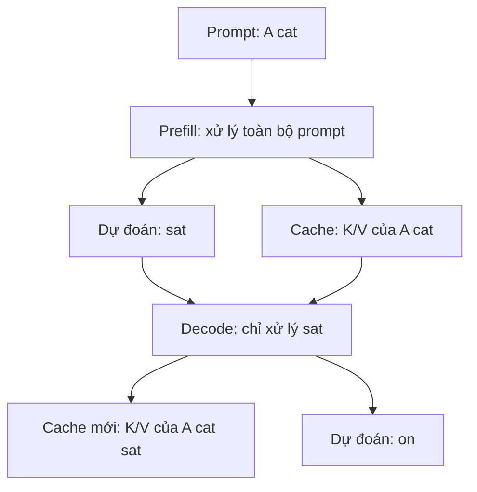

# KV Cache trong Transformer: “trí nhớ tạm” giúp GPT trả lời nhanh hơn

> Tài liệu này giải thích KV Cache từ trực giác đến mã PyTorch. Mục tiêu là giúp các bạn mới học đã biết sơ qua Transformer có thể hiểu: **Mô hình đang lưu gì, vì sao phải lưu, tensor đổi hình dạng ra sao và đoạn mã hoạt động thế nào**.

---

## 1. Vấn đề: GPT đang làm lại bài cũ

GPT không viết cả câu trong một lần. Nó sinh từng token:

```text
"A cat"  → dự đoán "sat"
"A cat sat" → dự đoán "on"
"A cat sat on" → dự đoán "the"
```

Một vòng lặp sinh văn bản đơn giản thường làm như sau:

```python
for _ in range(max_new_tokens):
    logits = model(all_tokens)        # gửi lại toàn bộ câu
    next_token = sample(logits[:, -1])
    all_tokens = torch.cat([all_tokens, next_token], dim=1)
```

Đoạn mã này đúng, nhưng lãng phí. Khi câu dài thêm một token, mô hình lại xử lý toàn bộ phần cũ.

Ví dụ:

| Lần chạy | Token được đưa vào mô hình | Công việc bị lặp |
|---|---|---|
| 1 | `A cat` | Chưa có |
| 2 | `A cat sat` | Tính lại cho `A`, `cat` |
| 3 | `A cat sat on` | Tính lại cho `A`, `cat`, `sat` |
| 4 | `A cat sat on the` | Tính lại gần như tất cả |

Hãy tưởng tượng bạn đang giải một bài toán dài. Mỗi khi viết thêm một dòng, bạn xóa bài và làm lại từ dòng đầu. Kết quả vẫn đúng, nhưng cách làm quá tốn thời gian.

Trong Self-Attention, phần bị tính lại đáng chú ý là **Key (K)** và **Value (V)** của những token cũ. Một token đã nằm trong quá khứ thì biểu diễn K/V của nó tại một tầng Transformer không tự nhiên thay đổi giữa các bước sinh tiếp theo. Vì vậy, ta có thể giữ lại và dùng tiếp.

---

## 2. KV Cache là gì?

KV Cache (Key-Value Cache) là một kỹ thuật lưu trữ tạm thời giúp các mô hình ngôn ngữ (LLM) tạo ra văn bản nhanh hơn rất nhiều và tiết kiệm chi phí tính toán.

Nếu không có KV Cache, LLM sẽ càng gõ càng chậm. Để hiểu tại sao, hãy bắt đầu từ bản chất cách LLM hoạt động.

**Mối liên hệ: LLM sinh từ như thế nào?**

Khi bạn yêu cầu LLM viết một câu, nó không tạo ra toàn bộ câu cùng lúc mà sinh từng từ một (token by token):

```
Bước 1: Nhận vào "Hà" -> Dự đoán từ tiếp theo là "Nội".
Bước 2: Nhận vào "Hà Nội" -> Dự đoán từ tiếp theo là "là".
Bước 3: Nhận vào "Hà Nội là" -> Dự đoán từ tiếp theo là "thủ".
Bước 4: Nhận vào "Hà Nội là thủ" -> Dự đoán từ tiếp theo là "đô".
```

Trong kiến trúc Transformer, cơ chế Self-Attention cần tính toán mối quan hệ giữa từ mới và tất cả các từ đứng trước nó. Để làm việc này, mô hình phải biến đổi mỗi từ thành 2 vectơ quan trọng: **Key (K) và Value (V)**.

**Vấn đề nếu không có KV Cache (Lãng phí tính toán)**

Ở Bước 4 `"Hà Nội là thủ"`:

- Mô hình phải tính toán lại K và V cho từ `"Hà"`.
- Tính lại K và V cho từ `"Nội"`.
- Tính lại K và V cho từ `"là"`.
- Tính lại K và V cho từ `"thủ"`.

Bạn có thể thấy: K và V của các từ `"Hà", "Nội", "là"` đã được tính từ các bước trước rồi, nhưng nếu không lưu lại, mô hình bắt buộc phải tính toán lại từ đầu cho mọi token cũ.

Khi đoạn văn dài đến hàng nghìn từ, việc tính lại toàn bộ quá khứ ở mỗi từ mới sẽ khiến tốc độ tạo văn bản chậm đi khủng khiếp (độ phức tạp $$O(N^2)$$).

**Giải pháp: KV Cache**

KV Cache giải quyết đúng lãng phí này bằng một nguyên lý đơn giản: Tính đến đâu, lưu lại đến đó.

- Lần đầu tiên: Khi xử lý câu lệnh (prompt) ban đầu, mô hình tính toán Key và Value cho tất cả các từ trong prompt rồi lưu vào bộ nhớ RAM/VRAM (gọi là KV Cache).

- Các bước tiếp theo: Khi sinh từ mới, mô hình chỉ tính Key và Value cho duy nhất từ mới đó.

- Sau đó, nó lấy các K và V cũ đã lưu trong KV Cache ra kết hợp với K và V mới để dự đoán từ tiếp theo.

Tóm lại:

1. Chỉ tính Q, K và V cho token mới.
2. Ghép K mới vào K cũ.
3. Ghép V mới vào V cũ.
4. Dùng Q mới để “nhìn” toàn bộ K/V trong cache.
5. Trả cache đã cập nhật cho bước sau.

Công thức ngắn gọn:

$$
K_{\text{all}} = \text{concat}(K_{\text{past}}, K_{\text{new}})
$$

$$
V_{\text{all}} = \text{concat}(V_{\text{past}}, V_{\text{new}})
$$

$$
Y_{\text{new}} = \text{softmax}\left( \frac{Q_{\text{new}} K_{\text{all}}^T}{\sqrt{d_h}} \right) V_{\text{all}}
$$

Trực giác dễ hình dung:

- **K** giống như nhãn ở gáy sách: giúp xác định thông tin nào có liên quan.
- **V** giống như nội dung hữu ích trong cuốn sách đó.
- **Q** là câu hỏi hiện tại.
- **KV Cache** là giá sách đã được sắp sẵn; không cần đem sách cũ đi phân loại lại mỗi lần có câu hỏi mới.

> KV Cache không phải “ký ức lâu dài” của chatbot. Nó chỉ tồn tại trong lúc mô hình đang xử lý một chuỗi hoặc một phiên sinh cụ thể. Khi cache bị xóa, mô hình không còn giữ các K/V đó.

**Bảng so sánh:**

| Tiêu chí | Không dùng KV Cache | Có dùng KV Cache |
| :--- | :--- | :--- |
| **Khối lượng tính toán** | Tăng theo cấp số nhân khi câu dài ra. | Giữ nguyên cho mỗi từ mới (chỉ tính 1 token). |
| **Tốc độ sinh chữ** | Càng về sau càng chậm. | Tốc độ ổn định, nhanh hơn gấp nhiều lần. |
| **Đổi lại (Trade-off)** | Tiết kiệm RAM/VRAM. | Tốn dung lượng VRAM để lưu bộ nhớ đệm KV. |

## 3. Hai giai đoạn: Prefill và Decode

Đây là cách nhìn rất quan trọng trong hệ thống LLM thực tế.

### 3.1. Prefill: đọc prompt lần đầu

Giả sử người dùng nhập:

```text
A cat
```

Mô hình phải xử lý cả prompt để:

- tạo logits dự đoán token tiếp theo;
- tạo K và V của `A`, `cat` ở từng tầng;
- lưu chúng vào cache.

Giai đoạn này gọi là **prefill**.

### 3.2. Decode: sinh từng token mới

Sau prefill, mô hình dự đoán `sat`. Ở vòng tiếp theo, nó chỉ cần nhận token `sat`, đồng thời dùng lại cache của `A cat`.



Trình tự đúng là:

```text
Xử lý "A cat"       → dự đoán "sat"
Xử lý riêng "sat"   → dự đoán "on"
Xử lý riêng "on"    → dự đoán "the"
```

Không phải đưa `sat` vào để dự đoán chính `sat`. Token đầu vào ở một bước được dùng để dự đoán token đứng **sau** nó.

---
